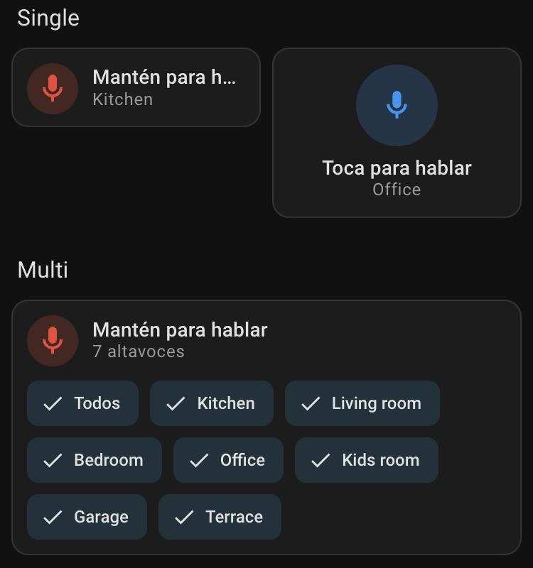

# Voice Announcement para Home Assistant

[](https://hacs.xyz/docs/faq/custom_repositories)
[](https://github.com/Cheerpipe/voice-announcement/releases)

*[Read in English](README.md)*

Háblale a tu casa. Presiona un botón en tu dashboard, di algo, suelta, y tu mensaje suena en los altavoces que elegiste: una habitación, varias o toda la casa.



## Qué incluye

- **Una tarjeta y un badge** que graban un mensaje de voz desde cualquier navegador o desde la app de Home Assistant.
- **Uno o varios altavoces.** Si indicas varios, la tarjeta muestra chips para elegir a dónde va el mensaje, con un atajo *Todos*. Puedes permitir varios a la vez o solo uno.
- **Mantener para hablar o tocar para hablar.** También funciona con teclado: mantén Espacio o Enter.
- **Modo anuncio.** En los altavoces compatibles, la música baja mientras hablas y luego continúa.
- **Suena en casi cualquier parlante.** Por defecto las grabaciones se convierten a MP3, así que HomePod, Google y Nest, Sonos, Music Assistant y la mayoría de los reproductores pueden reproducirlas.
- **Un editor visual** que se ve y funciona como los editores de tarjetas nativos de Home Assistant, en español e inglés.
- **Privado por defecto.** Para subir audio hace falta un usuario de Home Assistant con permiso para controlar los altavoces elegidos. Las grabaciones se borran solas a los 7 días.

## Requisitos

- Home Assistant 2026.6 o superior.
- `ffmpeg` y `ffprobe`. Ya vienen incluidos en Home Assistant OS y en las imágenes de contenedor oficiales.
- Un navegador o la app de Home Assistant con acceso al micrófono. Los navegadores solo permiten el micrófono en páginas **HTTPS** (o en `http://localhost`), así que abre Home Assistant por su dirección HTTPS.

## Instalación

### HACS (recomendado)

[](https://my.home-assistant.io/redirect/hacs_repository/?owner=Cheerpipe&repository=voice-announcement&category=integration)

1. En HACS, abre el menú de la esquina superior derecha y elige **Repositorios personalizados**.
2. Agrega `https://github.com/Cheerpipe/voice-announcement` con el tipo **Integración**.
3. Busca **Voice Announcement**, descárgalo y reinicia Home Assistant.
4. Ve a **Ajustes → Dispositivos y servicios → Añadir integración** y agrega **Voice Announcement**.

### Manual

1. Copia `custom_components/voice_announcement` dentro de la carpeta `custom_components` de tu configuración de Home Assistant.
2. Reinicia Home Assistant y agrega la integración desde **Ajustes → Dispositivos y servicios**.

La tarjeta y el badge se cargan solos. No hace falta agregar un recurso al dashboard.

## Agregar la tarjeta

Edita un dashboard, elige **Añadir tarjeta** y busca **Voice Announcement**. Elige uno o más altavoces y listo. Todo lo demás es opcional.


Lo mismo en YAML:

```yaml
type: custom:voice-announcement-card
entity_id: media_player.kitchen
```

### Elegir entre varios altavoces

Si le das una lista de altavoces, la tarjeta muestra un chip por cada uno. Toca los chips para decidir a dónde va el próximo mensaje. La tarjeta recuerda tu elección en cada dispositivo.

```yaml
type: custom:voice-announcement-card
entity_id:
  - media_player.kitchen
  - media_player.living_room
  - media_player.bedroom
selection_mode: multiple   # o "single" para permitir un solo altavoz a la vez
```

Con `selection_mode: multiple` también aparece el chip **Todos**. Con `single`, al elegir un altavoz se reemplaza el anterior.

### Un intercomunicador pequeño para un popup

Esta sección funciona sola o dentro de un popup. Usa siete altavoces llamados `media_player.player1` a `media_player.player7`:

```yaml
type: grid
cards:
  - type: heading
    heading: Intercomunicador
    icon: mdi:bullhorn
  - type: custom:voice-announcement-card
    layout: vertical
    selection_mode: multiple
    entity_id:
      - media_player.player1
      - media_player.player2
      - media_player.player3
      - media_player.player4
      - media_player.player5
      - media_player.player6
      - media_player.player7
```

Si usas [Browser Mod](https://github.com/thomasloven/hass-browser_mod), un botón puede abrir la misma tarjeta en un popup:

```yaml
type: button
name: Intercomunicador
icon: mdi:bullhorn
tap_action:
  action: perform-action
  perform_action: browser_mod.popup
  data:
    browser_id: THIS
    title: Intercomunicador
    content:
      type: custom:voice-announcement-card
      layout: vertical
      entity_id:
        - media_player.player1
        - media_player.player2
        - media_player.player3
        - media_player.player4
        - media_player.player5
        - media_player.player6
        - media_player.player7
```

### Badge

El badge es un botón redondo y compacto para la parte superior de una vista. Reproduce en todos los altavoces de su lista.

```yaml
type: custom:voice-announcement-badge
entity_id: media_player.kitchen
```

## Opciones

| Opción | Por defecto | Qué hace |
| --- | --- | --- |
| `entity_id` | obligatoria | Un reproductor multimedia o una lista de ellos. |
| `recording_mode` | `hold` | `hold` graba mientras mantienes el botón. `toggle` empieza con un toque y envía con el siguiente. |
| `selection_mode` | `multiple` | Con varios altavoces: `multiple` permite cualquier combinación, `single` solo uno a la vez. |
| `layout` | `horizontal` | `horizontal` se ve como una tarjeta tile. `vertical` pone un botón más grande sobre el texto. |
| `active_color` | `red` | Un nombre de color de Home Assistant (como `blue` o `primary`) o un color hexadecimal. |
| `microphone_icon` | `mdi:microphone` | Icono en reposo y mientras graba. |
| `speaker_icon` | `mdi:volume-high` | Icono mientras envía y reproduce. |
| `show_timer` | `true` | Muestra el tiempo de grabación y los altavoces elegidos bajo el estado. |
| `max_duration` | `30` | La grabación se detiene sola tras estos segundos (el servidor acepta hasta 120). |
| `min_duration` | `0.5` | Las grabaciones más cortas se descartan, así no se envían toques accidentales. |
| `auto_play` | `true` | Reproduce el mensaje apenas termina de subirse. |
| `announce` | `true` | Usa el modo anuncio en los altavoces compatibles. |
| `playback_start_delay` | `2` | Segundos que espera la tarjeta antes de indicar que está reproduciendo. Ajústalo a lo que tardan tus altavoces en empezar. |

### Opciones de formato de audio

Rara vez las necesitarás. Por defecto cada grabación se convierte a MP3, que casi cualquier altavoz puede reproducir.

| Opción | Por defecto | Qué hace |
| --- | --- | --- |
| `output_profile` | `default` | Los altavoces de destino: `default` (cualquiera), `homepod`, `google_home` o `custom`. |
| `transcoding` | `always` | `always` convierte cada grabación. `auto` evita la conversión cuando el perfil de altavoz acepta el formato grabado, así la reproducción empieza un poco antes. `never` nunca convierte y rechaza lo que el perfil no acepta. |
| `input_profile` | `default` | Qué formato de grabación intenta primero el navegador: `default`, `chrome` o `safari`. El editor muestra cuál usará tu navegador actual. |
| `input_mime_candidates` | – | Tu propia lista ordenada de formatos de grabación, por ejemplo `[audio/mp4, audio/webm;codecs=opus]`. |
| `transcode_target` | – | Ajustes de conversión: `codec` (`mp3` o `aac`), `bitrate` (`32k`–`192k`), `sample_rate` (8000–48000), `channels` (`1` o `2`). |
| `output_passthrough_rules` | – | Formatos que tus altavoces reproducen tal cual, por ejemplo `[{mime_type: audio/mpeg}]`. |

Para HomePod prueba `input_profile: safari`, `output_profile: homepod`, `transcoding: auto`. Para Google y Nest prueba `input_profile: chrome`, `output_profile: google_home`, `transcoding: auto`.

## Estilos

Cada parte de la tarjeta se puede cambiar con variables CSS, por ejemplo con [card-mod](https://github.com/thomasloven/lovelace-card-mod) o en un tema:

```yaml
card_mod:
  style: |
    :host {
      --voice-announcement-button-size: 96px;
      --voice-announcement-button-color-recording: var(--green-color);
    }
```

La lista completa de variables está en el [README en inglés](README.md#styling). Sin card-mod también puedes usar `button_css`, `status_css`, `timer_css` y `text_css` (en el editor, en **Estilos personalizados**). Aceptan declaraciones CSS simples y solo se aplican propiedades visuales seguras.

## Grabaciones y acciones

Las grabaciones se guardan en `/config/voice_announcement`. Se conservan las 100 más recientes durante un máximo de 7 días, y puedes verlas en **Multimedia → Voice Announcement**. Los administradores también tienen dos acciones:

```yaml
action: voice_announcement.cleanup
data:
  keep_days: 1
```

```yaml
action: voice_announcement.delete_recording
data:
  recording_id: 0123456789abcdef0123456789abcdef
```

## Solución de problemas

**La tarjeta no aparece en el selector.** Reinicia Home Assistant después de instalar, confirma que la integración está agregada en **Dispositivos y servicios** y recarga el navegador. En la app de Home Assistant, desliza hacia abajo para refrescar o ciérrala y ábrela de nuevo.

**"El micrófono requiere HTTPS".** Los navegadores solo permiten el micrófono en páginas seguras. Abre Home Assistant por su dirección HTTPS (por ejemplo, la de Home Assistant Cloud o tu proxy inverso).

**"Se denegó el acceso al micrófono".** Permite el micrófono para tu dirección de Home Assistant en los ajustes del sitio del navegador, o para la app de Home Assistant en los ajustes del teléfono.

**El mensaje se sube pero no suena nada.** Comprueba que el altavoz puede reproducir contenido desde Home Assistant: pruébalo desde **Multimedia** en la barra lateral. Si la tarjeta muestra un error después de "Enviando…", el altavoz rechazó el mensaje; el texto del error y el registro de Home Assistant indican el motivo.

**La reproducción empieza tarde.** Usa `transcoding: auto` con el perfil que corresponde a tus altavoces y ajusta `playback_start_delay`. La línea del registro *Processed Voice Announcement upload* muestra cuánto tardó cada paso.

**Errores que mencionan ffmpeg o ffprobe.** Instálalos donde corre Home Assistant. Home Assistant OS y los contenedores oficiales ya los incluyen.

## Licencia

[MIT](LICENSE)
