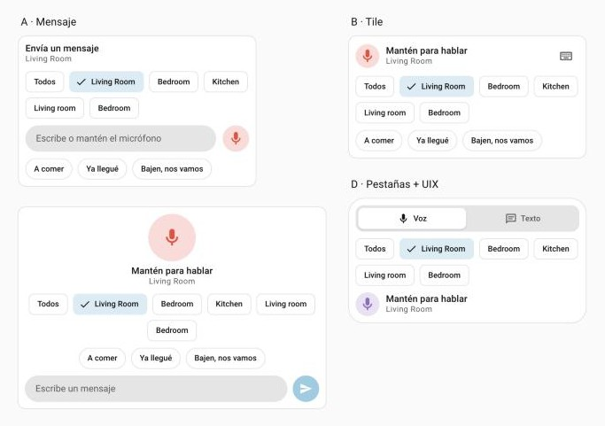
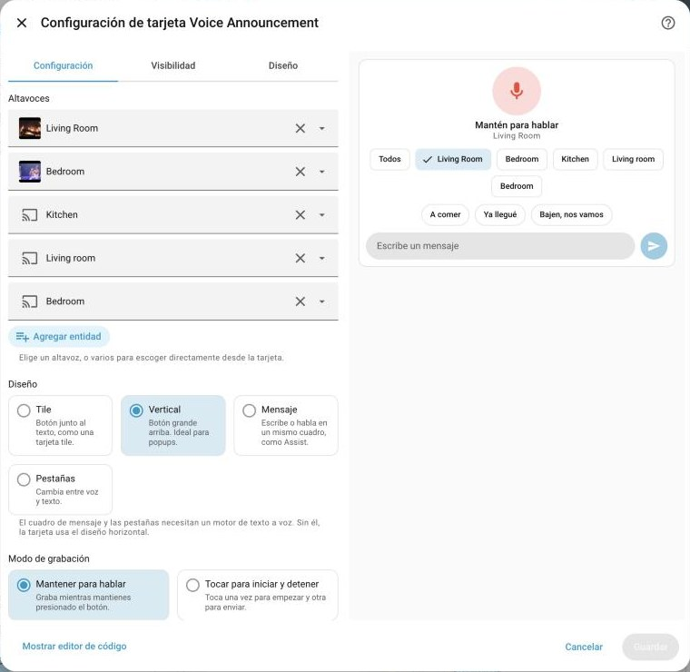

# Voice Announcement para Home Assistant

[](https://hacs.xyz/docs/faq/custom_repositories)
[](https://github.com/Cheerpipe/voice-announcement/actions/workflows/validate.yml)
[](https://github.com/Cheerpipe/voice-announcement/releases)
[](LICENSE)

*[Read in English](README.md)*

Háblale a tu casa. Presiona un botón en tu dashboard y di algo, o escribe un mensaje, y suena en los altavoces que elegiste: una habitación, varias o toda la casa.



## Qué incluye

- **Una tarjeta y un badge** que graban un mensaje de voz desde cualquier navegador o desde la app de Home Assistant.
- **Mensajes escritos y mensajes rápidos.** Si agregas un motor de texto a voz, la misma tarjeta lee en voz alta lo que escribes. Guarda las frases que más usas, con icono si quieres, y envíalas con un toque.
- **Cuatro diseños:** tile, un botón vertical grande para popups, un cuadro de mensaje como Assist y pestañas de voz y texto.
- **Uno o varios altavoces.** Si indicas varios, la tarjeta muestra chips para elegir a dónde va el mensaje, con un atajo *Todos*. Puedes permitir varios a la vez o solo uno, y darle a cada altavoz su propio nombre, icono y color.
- **Mantener para hablar o tocar para hablar.** También con teclado: mantén Espacio o Enter, y presiona Enter para enviar texto.
- **Modo anuncio.** En los altavoces compatibles, la música baja durante el mensaje y luego continúa.
- **Suena en casi cualquier parlante.** Por defecto las grabaciones se convierten a MP3, así que HomePod, Google y Nest, Sonos, Music Assistant y la mayoría de los reproductores pueden reproducirlas.
- **Personaliza todo** con [UIX](https://github.com/Lint-Free-Technology/uix), card-mod o variables CSS.
- **Un editor visual** que se ve y funciona como los editores de tarjetas nativos de Home Assistant, en español e inglés.
- **Entidades para automatizaciones y diagnóstico.** Muestran qué se está recibiendo, procesando o reproduciendo y en qué altavoz, permiten reaccionar a grabaciones nuevas y avisan de problemas, como que falte ffmpeg.
- **Privado por defecto.** Para subir audio hace falta un usuario de Home Assistant con permiso para controlar los altavoces elegidos. Las grabaciones se borran solas a los 7 días.

## Requisitos

- Home Assistant 2026.6 o superior.
- `ffmpeg` y `ffprobe`. Ya vienen incluidos en Home Assistant OS y en las imágenes de contenedor oficiales.
- Un navegador o la app de Home Assistant con acceso al micrófono. Los navegadores solo permiten el micrófono en páginas **HTTPS** (o en `http://localhost`), así que abre Home Assistant por su dirección HTTPS.
- Para mensajes escritos: cualquier integración de texto a voz, como Home Assistant Cloud, Google Translate o Piper.

## Instalación

### HACS (recomendado)

[](https://my.home-assistant.io/redirect/hacs_repository/?owner=Cheerpipe&repository=voice-announcement&category=integration)

1. En HACS, abre el menú de la esquina superior derecha y elige **Repositorios personalizados**.
2. Agrega `https://github.com/Cheerpipe/voice-announcement` con el tipo **Integración**.
3. Busca **Voice Announcement**, descárgalo y reinicia Home Assistant.
4. Ve a **Ajustes → Dispositivos y servicios → Añadir integración** y agrega **Voice Announcement**.

### Manual

1. Copia `custom_components/voice_announcement` dentro de la carpeta `custom_components` de tu configuración de Home Assistant.
2. Reinicia Home Assistant y agrega la integración desde **Ajustes → Dispositivos y servicios**.

La tarjeta y el badge se cargan solos. No hace falta agregar un recurso al dashboard.

## Agregar la tarjeta

Edita un dashboard, elige **Añadir tarjeta** y busca **Voice Announcement**. Elige uno o más altavoces y un diseño, y listo. Todo lo demás es opcional.



Lo mismo en YAML:

```yaml
type: custom:voice-announcement-card
entities:
  - media_player.kitchen
```

### Diseños

| Diseño | Cómo se ve | Ideal para |
| --- | --- | --- |
| `horizontal` | Una tarjeta tile: botón junto al texto. Con texto a voz, un botón de teclado abre el cuadro de mensaje. | Dashboards compactos. |
| `vertical` | Un botón grande arriba y el cuadro de mensaje debajo. | Popups y teléfonos. |
| `composer` | Un cuadro de mensaje con el micrófono al lado, como Assist. El micrófono se convierte en "enviar" al escribir. | Hablar y escribir por igual. |
| `tabs` | Pestañas *Voz* y *Texto*. | Separar voz y texto. |

`composer` y `tabs` necesitan un motor de texto a voz. Sin él, la tarjeta usa el diseño `horizontal`.

### Elegir entre varios altavoces

Si le das una lista de altavoces, la tarjeta muestra un chip por cada uno, en el mismo orden. Toca los chips para decidir a dónde va el próximo mensaje. La tarjeta recuerda tu elección en cada dispositivo.

```yaml
type: custom:voice-announcement-card
entities:
  - entity: media_player.kitchen
    name: Cocina
    icon: mdi:silverware-fork-knife
    color: orange
  - media_player.living_room
  - entity: media_player.bedroom
    icon: mdi:bed
selection_mode: multiple   # o "single" para permitir un solo altavoz a la vez
```

Cada altavoz puede ser solo su entidad o tener su propio `name`, `icon` y `color`. El color tiñe el chip cuando está elegido. En el editor, arrastra los altavoces para cambiar el orden y usa el lápiz para personalizar uno.

Con `selection_mode: multiple` también aparece el chip **Todos**. Con `single`, al elegir un altavoz se reemplaza el anterior.

### Mensajes escritos y mensajes rápidos

Elige un motor en **Texto a voz** y la tarjeta tendrá un cuadro de mensaje. Los mensajes rápidos aparecen como chips que se envían con un toque; puedes darles un icono y arrastrarlos en el editor para cambiar el orden.

```yaml
type: custom:voice-announcement-card
layout: composer
entity_id:
  - media_player.kitchen
  - media_player.living_room
tts_engine: tts.home_assistant_cloud
tts_language: es-ES        # opcional
tts_voice: ElviraNeural    # opcional, solo si tu motor tiene voces
tts_cache: true            # opcional, reutiliza el audio de mensajes repetidos
quick_messages:
  - message: A comer
    icon: mdi:silverware-fork-knife
  - message: Ya llegué
    icon: mdi:home-import-outline
  - Nos vamos en 5 minutos
```

Los mensajes escritos suenan en los mismos altavoces que las grabaciones y con el mismo modo anuncio.

### Un intercomunicador pequeño para un popup

Esta sección funciona sola o dentro de un popup. Usa siete altavoces llamados `media_player.player1` a `media_player.player7`:

```yaml
type: grid
cards:
  - type: heading
    heading: Intercomunicador
    icon: mdi:bullhorn
  - type: custom:voice-announcement-card
    layout: vertical
    selection_mode: multiple
    tts_engine: tts.home_assistant_cloud
    quick_messages:
      - message: A comer
        icon: mdi:silverware-fork-knife
      - Nos vamos
    entities:
      - media_player.player1
      - media_player.player2
      - media_player.player3
      - media_player.player4
      - media_player.player5
      - media_player.player6
      - media_player.player7
```

Si usas [Browser Mod](https://github.com/thomasloven/hass-browser_mod), un botón puede abrir la misma tarjeta en un popup:

```yaml
type: button
name: Intercomunicador
icon: mdi:bullhorn
tap_action:
  action: perform-action
  perform_action: browser_mod.popup
  data:
    browser_id: THIS
    title: Intercomunicador
    content:
      type: custom:voice-announcement-card
      layout: vertical
      tts_engine: tts.home_assistant_cloud
      entities:
        - media_player.player1
        - media_player.player2
        - media_player.player3
        - media_player.player4
        - media_player.player5
        - media_player.player6
        - media_player.player7
```

### Badge

El badge es un botón redondo y compacto para la parte superior de una vista. Graba voz y la reproduce en todos los altavoces de su lista.

```yaml
type: custom:voice-announcement-badge
entities:
  - media_player.kitchen
```

## Opciones

| Opción | Por defecto | Qué hace |
| --- | --- | --- |
| `entities` | obligatoria | Los altavoces, en el orden de los chips. Cada elemento es una entidad o tiene `entity`, `name`, `icon` y `color`. El antiguo `entity_id` (una entidad o una lista) sigue funcionando. |
| `layout` | `horizontal` | `horizontal`, `vertical`, `composer` o `tabs`. Ver [Diseños](#diseños). |
| `recording_mode` | `hold` | `hold` graba mientras mantienes el botón. `toggle` empieza con un toque y envía con el siguiente. |
| `selection_mode` | `multiple` | Con varios altavoces: `multiple` permite cualquier combinación, `single` solo uno a la vez. |
| `tts_engine` | – | Una entidad de texto a voz, como `tts.home_assistant_cloud`. Activa los mensajes escritos y rápidos. |
| `tts_language` | la del motor | Idioma de los mensajes escritos, como `es-ES`. Omítelo para usar el idioma configurado en tu integración de texto a voz. |
| `tts_voice` | la del motor | Nombre de la voz, en motores que ofrecen varias. |
| `tts_cache` | `true` | Reutiliza el audio generado cuando se envía el mismo mensaje otra vez, así suena antes. |
| `quick_messages` | – | Frases para enviar con un toque. Cada elemento es un texto o tiene `message` e `icon`. |
| `active_color` | `red` | Un nombre de color de Home Assistant (como `blue` o `primary`) o un color hexadecimal. |
| `microphone_icon` | `mdi:microphone` | Icono en reposo y mientras graba. |
| `speaker_icon` | `mdi:volume-high` | Icono mientras envía y reproduce. |
| `show_timer` | `true` | Muestra el tiempo de grabación y los altavoces elegidos bajo el estado. |
| `max_duration` | `30` | La grabación se detiene sola tras estos segundos (el servidor acepta hasta 120). |
| `min_duration` | `0.5` | Las grabaciones más cortas se descartan, así no se envían toques accidentales. |
| `auto_play` | `true` | Reproduce la grabación apenas termina de subirse. |
| `announce` | `true` | Usa el modo anuncio en los altavoces compatibles. |
| `playback_start_delay` | `2` | Segundos que espera la tarjeta antes de indicar que está reproduciendo. Ajústalo a lo que tardan tus altavoces en empezar. |

### Opciones de formato de audio

Rara vez las necesitarás. Por defecto cada grabación se convierte a MP3, que casi cualquier altavoz puede reproducir.

| Opción | Por defecto | Qué hace |
| --- | --- | --- |
| `output_profile` | `default` | Los altavoces de destino: `default` (cualquiera), `homepod`, `google_home` o `custom`. |
| `transcoding` | `always` | `always` convierte cada grabación. `auto` evita la conversión cuando el perfil de altavoz acepta el formato grabado, así la reproducción empieza un poco antes. `never` nunca convierte y rechaza lo que el perfil no acepta. |
| `input_profile` | `default` | Qué formato de grabación intenta primero el navegador: `default`, `chrome` o `safari`. El editor muestra cuál usará tu navegador actual. |
| `input_mime_candidates` | – | Tu propia lista ordenada de formatos de grabación, por ejemplo `[audio/mp4, audio/webm;codecs=opus]`. |
| `transcode_target` | – | Ajustes de conversión: `codec` (`mp3` o `aac`), `bitrate` (`32k`–`192k`), `sample_rate` (8000–48000), `channels` (`1` o `2`). |
| `output_passthrough_rules` | – | Formatos que tus altavoces reproducen tal cual, por ejemplo `[{mime_type: audio/mpeg}]`. |

Para HomePod prueba `input_profile: safari`, `output_profile: homepod`, `transcoding: auto`. Para Google y Nest prueba `input_profile: chrome`, `output_profile: google_home`, `transcoding: auto`.

## Estilos con UIX

Cada parte de la tarjeta se puede cambiar con [UIX](https://github.com/Lint-Free-Technology/uix). Los cuatro diseños comparten los mismos elementos, así que un estilo funciona con cualquier diseño. Los estilos van en `uix: style:`; `:host` es la tarjeta y `ha-card` su marco. card-mod funciona igual con `card_mod: style:`.

```yaml
type: custom:voice-announcement-card
layout: tabs
entities:
  - media_player.kitchen
tts_engine: tts.home_assistant_cloud
uix:
  style: |
    ha-card {
      --voice-announcement-active-color: var(--purple-color);
      border-radius: 24px;
    }
    .quick-message {
      background: color-mix(in srgb, var(--purple-color) 14%, transparent);
      border-color: transparent;
    }
    :host([state="recording"]) ha-card {
      background: color-mix(in srgb, var(--red-color) 8%, var(--card-background-color));
    }
```

La tarjeta indica lo que está haciendo con atributos en `:host` (`state`, `layout`, `tab`, `has-tts`, `has-quick`, `has-targets`, `has-text`, `composing`), así puedes dar estilo a cada momento, por ejemplo `:host([state="playing"]) .status { color: var(--green-color); }`.

La lista completa de elementos, estados y variables CSS está en el [README en inglés](README.md#styling-with-uix). Sin UIX también puedes usar `button_css`, `status_css`, `timer_css` y `text_css` (en el editor, en **Estilos personalizados**). Aceptan declaraciones CSS simples y solo se aplican propiedades visuales seguras.

## Grabaciones y acciones

Las grabaciones se guardan en `/config/voice_announcement`. Se conservan las 100 más recientes durante un máximo de 7 días, y puedes verlas en **Multimedia → Voice Announcement**. Los mensajes escritos los maneja tu integración de texto a voz y no se guardan aquí. Cualquier usuario puede usar `voice_announcement.play` para repetir una grabación (`last` reproduce la más reciente) o leer un mensaje en voz alta. Acepta entidades, dispositivos, áreas, plantas y etiquetas como destino:

```yaml
action: voice_announcement.play
target:
  area_id: cocina
data:
  recording_id: last
```

```yaml
action: voice_announcement.play
target:
  entity_id: media_player.cocina
data:
  message: La cena está lista
  tts_engine: tts.home_assistant_cloud
```

Los administradores tienen además dos acciones:

```yaml
action: voice_announcement.cleanup
data:
  keep_days: 1
```

```yaml
action: voice_announcement.delete_recording
data:
  recording_id: 0123456789abcdef0123456789abcdef
```

## Entidades

La integración agrega un dispositivo **Voice Announcement** con estas entidades. Los IDs de abajo son los que se generan en una instalación en inglés; en español los nombres se traducen y los IDs pueden cambiar.

**Actividad**

| Entidad | Qué muestra |
|---|---|
| `sensor.voice_announcement_status` | `idle`, `receiving`, `processing` o `playing`; si pasan varias cosas a la vez gana la fase más avanzada. Atributos: `targets`, `type` (`voice` o `tts`), `user`, `recording_id`, `started_at` y `active_jobs` con cada subida y anuncio en curso. |
| `binary_sensor.voice_announcement_receiving` | Encendido mientras llega una subida. `targets` dice a dónde va. |
| `binary_sensor.voice_announcement_processing` | Encendido mientras se valida y convierte una subida. |
| `binary_sensor.voice_announcement_playing` | Encendido mientras suena un anuncio en cualquier altavoz. |
| `binary_sensor.voice_announcement_playing_on_<altavoz>` | Uno por cada altavoz que haya recibido un anuncio; encendido mientras suena en él. |

**Grabaciones y anuncios**

| Entidad | Qué muestra |
|---|---|
| `sensor.voice_announcement_last_recording` | Cuándo se hizo la última grabación, con su `recording_id`, `media_source_id`, `url`, `targets`, `user` y `duration`. |
| `sensor.voice_announcement_last_recording_duration` | Su duración en segundos. |
| `sensor.voice_announcement_recordings_today` | Grabaciones desde la medianoche. |
| `sensor.voice_announcement_last_announcement` | Cuándo empezó el último anuncio, con su tipo, altavoces, resultado (`ok`, `partial` o `failed`) y por qué terminó. |
| `event.voice_announcement_recording` | Dispara `recorded`, `deleted`, `cleanup` y `failed` (subida fallida). |
| `event.voice_announcement_announcement` | Dispara `started`, `finished` y `failed`. |
| `button.voice_announcement_clean_up_old_recordings` | Elimina las grabaciones de más de 7 días. |
| `button.voice_announcement_delete_last_recording` | Elimina la grabación más reciente. |

**Diagnóstico**: grabaciones almacenadas, espacio usado, grabación más antigua, estado de la última subida (con el motivo si falló), subidas fallidas, tiempo del último procesamiento (con lo que tardó cada paso), subidas convertidas (%), subidas en curso, última limpieza, reproducciones fallidas, y dos sensores de problema que se encienden si falta **FFmpeg** o **FFprobe**.

### Cuándo se considera que un mensaje está sonando

Los anuncios que envía la tarjeta, o la acción `voice_announcement.play`, se siguen desde que se pide a los altavoces que reproduzcan hasta que pasa la duración del mensaje. Los altavoces que informan lo que reproducen lo terminan antes si se detienen, o después si siguen reproduciéndolo (hasta un minuto extra). Los anuncios enviados directamente con `media_player.play_media` o `tts.speak` no se siguen.

### Eventos para automatizaciones

Además de las entidades de evento, cada paso dispara un evento que puedes usar como disparador: `voice_announcement_receiving_started`, `voice_announcement_processing_started`, `voice_announcement_recorded`, `voice_announcement_upload_failed`, `voice_announcement_deleted`, `voice_announcement_cleanup`, `voice_announcement_playback_started`, `voice_announcement_playback_finished` y `voice_announcement_playback_failed`. Incluyen `recording_id`, `targets`, `type` y `user` cuando corresponde.

```yaml
triggers:
  - trigger: state
    entity_id: binary_sensor.voice_announcement_playing_on_living_room
    to: "on"
actions:
  - action: media_player.volume_mute
    target:
      entity_id: media_player.living_room_tv
    data:
      is_volume_muted: true
```

## Solución de problemas

**La tarjeta no aparece en el selector.** Reinicia Home Assistant después de instalar, confirma que la integración está agregada en **Dispositivos y servicios** y recarga el navegador. En la app de Home Assistant, desliza hacia abajo para refrescar o ciérrala y ábrela de nuevo.

**"El micrófono requiere HTTPS".** Los navegadores solo permiten el micrófono en páginas seguras. Abre Home Assistant por su dirección HTTPS (por ejemplo, la de Home Assistant Cloud o tu proxy inverso).

**"Se denegó el acceso al micrófono".** Permite el micrófono para tu dirección de Home Assistant en los ajustes del sitio del navegador, o para la app de Home Assistant en los ajustes del teléfono.

**El mensaje se sube pero no suena nada.** Comprueba que el altavoz puede reproducir contenido desde Home Assistant: pruébalo desde **Multimedia** en la barra lateral. Si la tarjeta muestra un error después de "Enviando…", el altavoz rechazó el mensaje. Pasa el cursor sobre el error para ver el motivo técnico, o revisa el registro de Home Assistant.

**Los mensajes escritos muestran "No se pudo reproducir en los altavoces" con "Invalid options" en el detalle.** Tu motor no acepta el `tts_voice` o `tts_language` que configuraste. Bórralos para usar los valores del motor.

**La reproducción empieza tarde.** Usa `transcoding: auto` con el perfil que corresponde a tus altavoces y ajusta `playback_start_delay`. La línea del registro *Processed Voice Announcement upload* muestra cuánto tardó cada paso.

**Errores que mencionan ffmpeg o ffprobe.** Instálalos donde corre Home Assistant. Home Assistant OS y los contenedores oficiales ya los incluyen.

## Licencia

[MIT](LICENSE)
